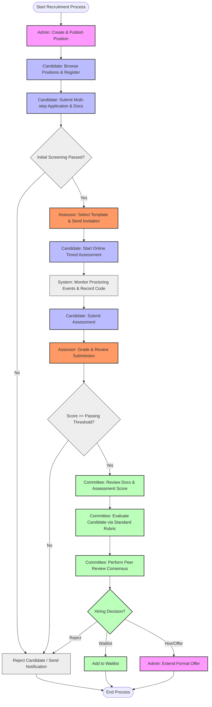
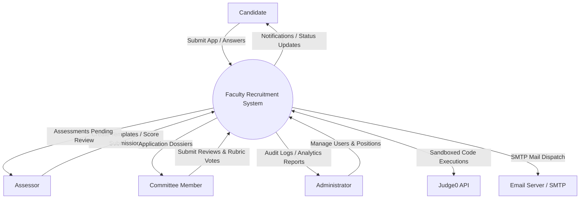
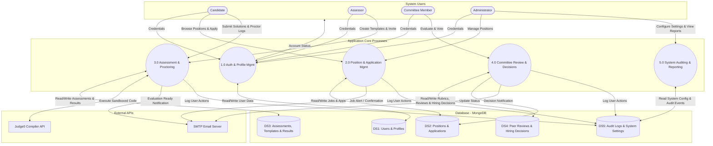
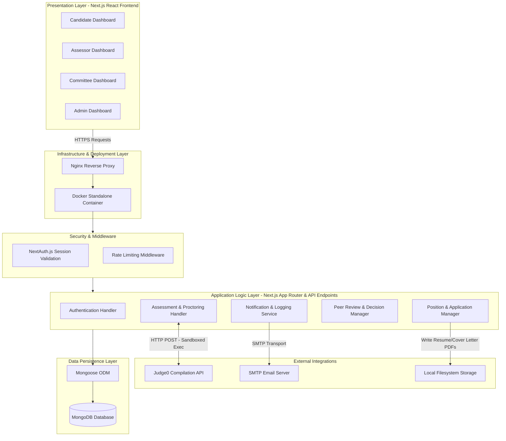

# Recruitment System Thesis Diagrams

This document contains the Mermaid diagrams detailing the workflows, processes, use cases, and architecture of the Faculty Recruitment System. These diagrams can be rendered in any Markdown viewer supporting Mermaid (such as GitHub, VS Code with Mermaid extensions, or Mermaid Live Editor).

---

## 1. End-to-End Recruitment Process Flowchart

This flowchart outlines the complete lifecycle of a recruitment campaign, starting from the admin publishing a vacancy to the candidate applying, undergoing automated assessment with online proctoring, assessor evaluation, committee peer review, and the final hiring decision.

---

## 2. Data Flow Diagrams (DFD)

The Data Flow Diagrams represent how information flows through the system, mapping external inputs to process flows, database changes, and external third-party integrations.

### Level 0: System Context Diagram

The Context Diagram shows the primary entities interacting with the boundaries of the Recruitment System.

### Level 1: System Processes & Data Stores Diagram

The Level 1 DFD decomposes the system boundaries into core processes (matching the application controller logic) and data stores (matching the MongoDB collections).

---

## 3. Use Case Diagram

This use case diagram models the interactions of each user role (Actor) with the sub-components and dashboards of the Next.js recruitment app.

```mermaid
graph TD
    %% Use Case Diagram styling & layout
    classDef actor fill:#def,stroke:#333,stroke-width:2px;
    classDef uc fill:#fff,stroke:#333,stroke-width:1px;

    %% Actors
    Cand[Candidate]:::actor
    Assess[Assessor]:::actor
    Comm[Committee Member]:::actor
    Admin[Administrator]:::actor

    %% Use Cases
    subgraph Candidate_UC [Candidate Use Cases]
        UC_Browse(["Browse & Search Positions"]):::uc
        UC_Apply(["Submit Job Application"]):::uc
        UC_TakeTest(["Complete Timed Assessment"]):::uc
        UC_Proctor(["Proctor Session Interaction"]):::uc
        UC_ViewStatus(["Track Application Status"]):::uc
    end

    subgraph Assessor_UC [Assessor Use Cases]
        UC_Temp(["Manage Assessment Templates"]):::uc
        UC_Invite(["Manage Assessment Invitations"]):::uc
        UC_Grade(["Score Candidate Assessments"]):::uc
        UC_ViewAn(["View Assessment Analytics"]):::uc
    end

    subgraph Committee_UC [Committee Use Cases]
        UC_RevApp(["Review Application & Docs"]):::uc
        UC_Rubric(["Evaluate Candidate Rubric"]):::uc
        UC_Consensus(["Submit Committee Decision"]):::uc
    end

    subgraph Admin_UC [Admin Use Cases]
        UC_Users(["Manage System Users & Roles"]):::uc
        UC_Pos(["Manage Positions"]):::uc
        UC_Logs(["Review System Audit Logs"]):::uc
        UC_Config(["Configure SMTP/Judge0 API"]):::uc
    end

    %% Auth & Core Use Case (shared)
    UC_Login(["Authenticate (Register / Login)"]):::uc

    %% Associations
    Cand --> UC_Login
    Cand --> UC_Browse
    Cand --> UC_Apply
    Cand --> UC_TakeTest
    Cand --> UC_ViewStatus
    
    Assess --> UC_Login
    Assess --> UC_Temp
    Assess --> UC_Invite
    Assess --> UC_Grade
    Assess --> UC_ViewAn

    Comm --> UC_Login
    Comm --> UC_RevApp
    Comm --> UC_Rubric
    Comm --> UC_Consensus

    Admin --> UC_Login
    Admin --> UC_Users
    Admin --> UC_Pos
    Admin --> UC_Logs
    Admin --> UC_Config

    %% Include / Extend relationships
    UC_Apply -.->|"<<include>>"| UC_Login
    UC_TakeTest -.->|"<<include>>"| UC_Login
    UC_TakeTest -.->|"<<include>>"| UC_Proctor
    UC_RevApp -.->|"<<include>>"| UC_Login
    UC_Consensus -.->|"<<include>>"| UC_Login
    UC_Grade -.->|"<<include>>"| UC_Login
```

---

## 4. System Architecture Diagram

This diagram displays the high-level components of the web application, showing a modularized multi-tier layout starting from the Nginx proxy, Next.js middleware protection, down to the controller layer, local filesystems, external API execution, and NoSQL databases.

